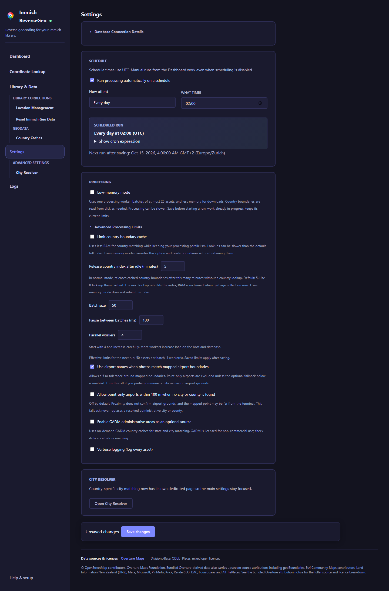

# Configuration

<div class="section-intro">
The Settings page is intentionally small. Most users only need to check the database connection, pick a schedule, and tune how aggressively processing should run. Country-specific city matching now lives on its own City Resolver page.
</div>

For manual runs, coordinate testing, and reset tools, see [Using the App](./using-the-app.md).

## Database settings

Database values are environment-backed and shown as read-only in the UI.

The app reads:

- `DB_HOSTNAME` (or the existing `DB_HOST` setting)
- `DB_PORT`
- `DB_USERNAME`
- `DB_PASSWORD`
- `DB_DATABASE_NAME`

These values are required because the app reads and updates Immich data directly. Passwords containing semicolons, quotes, or spaces are supported; pass the exact password through `DB_PASSWORD`, following your container or host environment's quoting rules.

For the database host, a nonblank `DB_HOST` takes precedence over `DB_HOSTNAME`. If neither has a nonblank value, the host defaults to `database`. You can reuse Immich's `DB_HOSTNAME` value for an external database without renaming it.

<div class="step-grid">
  <div class="step-card">
    <h3>Read-only by design</h3>
    <p>The database values shown in the UI come from the running environment and are there as a sanity check, not for editing.</p>
  </div>
  <div class="step-card">
    <h3>Keep them in Docker or your host environment</h3>
    <p>Set the database values where you launch the app, then restart it if you change them.</p>
  </div>
</div>

## Saving settings

Settings and City Resolver show whether changes are saved. **Save changes** saves the values present when you click it. If you keep editing during a save, those later edits stay pending for another save. Leaving an editor with unsaved changes asks for confirmation.

The save bar stays available as you scroll. Settings validates enabled schedules and processing limits before saving; correct the displayed error before trying again. Saved expressions that do not fit a preset remain in **Advanced custom schedule**, including invalid values. Invalid enabled schedules must be corrected before saving; they are not automatically clamped to a different schedule.

The two editors save their own sections, so saving City Resolver does not overwrite processing or schedule changes made elsewhere. **Test Connection** checks the environment-backed database connection without saving settings.


Saving replaces the settings file only after the new values have been written completely. If a save fails, the previous file remains available. Database credentials stay in the environment.

## Photo previews and Immich links

Live location previews and saved reports can show photo thumbnails and an **Open in Immich** link. This connection is optional; location processing still uses your database settings.

Add these environment variables to the Immich ReverseGeo service, then recreate or restart it:

| Variable | Purpose |
|---|---|
| `IMMICH_URL` | Immich server URL reachable from Immich ReverseGeo, such as `http://immich-server:2283`. |
| `IMMICH_WEB_URL` | Optional URL used by your browser, such as `https://photos.example.com`. Defaults to `IMMICH_URL`. |
| `IMMICH_API_KEY` | Immich API key with `asset.view` permission and access to the photos being previewed. |

```yaml
environment:
  IMMICH_URL: http://immich-server:2283
  IMMICH_WEB_URL: https://photos.example.com
  IMMICH_API_KEY: ${REVERSEGEO_IMMICH_API_KEY}
```

Put `REVERSEGEO_IMMICH_API_KEY` in your compose environment or secrets-backed deployment configuration. The key stays on the server and is not stored in settings or saved reports. An API key can only show photos its Immich account can access; a database-wide preview may include photos belonging to other users.

You can configure only `IMMICH_WEB_URL` if you want original-photo links without thumbnails. Thumbnails are fetched on demand for assets in saved preview reports and are not saved as image files. Missing thumbnails, denied access, or an unavailable Immich server show **Preview unavailable** while the saved location results remain usable. Original-photo links open Immich in a new tab and use your normal Immich sign-in.

## Processing settings

The Settings page lets you control:

- whether processing runs automatically
- when it runs, using simple presets or a custom cron expression
- batch size, delay, and parallelism
- low-memory mode for hosts with limited RAM
- how long country boundaries stay cached in RAM when idle
- whether a mapped airport boundary containing the coordinate can override the city name
- whether GADM administrative areas are enabled as an optional source
- whether GADM should be preferred over cached Overture divisions
- whether split-territory GADM fallback families should be tried
- whether every asset is written to the log

Most users should stay on the preset schedule options. Custom cron expressions can also schedule infrequent runs, such as once per year. Manual runs from the dashboard still work even when automatic scheduling is disabled.

All schedule times use **UTC**. Settings previews the next occurrence in your browser's timezone; local clock changes do not change the UTC schedule. The preview reflects your current edits and applies only after saving. Memory tuning, batch size, pause between batches, and parallel workers are under **Advanced Processing Limits**. The page shows effective batch and worker limits, including low-memory overrides.

??? example "See the schedule and processing settings"
    { .doc-screenshot .on-glb }

<div class="feature-grid">
  <div class="card">
    <h3>Schedule</h3>
    <p>Choose when the app should run automatically, from simple presets up to a custom cron schedule.</p>
  </div>
  <div class="card">
    <h3>Batch size</h3>
    <p>Controls how many photos are processed at a time before the next pause or write cycle.</p>
  </div>
  <div class="card">
    <h3>Parallelism</h3>
    <p>Controls how much work the app does at once. Higher values can be faster, but they also put more load on the system and database.</p>
  </div>
  <div class="card">
    <h3>Airport matching</h3>
    <p>Leave it on if airport names are useful to you. Turn it off if you prefer commune or city names for photos taken on airport grounds.</p>
  </div>
  <div class="card">
    <h3>Optional GADM source</h3>
    <p>You can enable GADM as an extra administrative boundary source, either as a fallback behind Overture or as the preferred admin source.</p>
  </div>
</div>

### Airport matching

When enabled, airport matching uses an airport name only if the coordinate falls inside its mapped polygon boundary or within 5 m of its edge. This small tolerance accommodates minor GPS and mapping differences. Point-only airports are excluded by default. Airports with missing or invalid boundaries are excluded. A nearby airport or overlapping bounding box is not enough, even when the city is missing; the app keeps the administrative result and its usual state/country fallback.

Use Lookup to check a known airport photo and a nearby photo first. The airport trace distinguishes a boundary match with the 5 m tolerance, outside boundary, and boundary unavailable. Missing or inaccurate polygons can prevent airport matching. Turn airport matching off if you prefer city or commune names. Existing Immich names are not rewritten automatically; use [Location Management](./using-the-app.md#location-management) to scan, review, and apply selected corrections.

#### Optional point-only airport fallback

Enable **Allow point-only airports within 100 m when no city or county is found** under Settings → Processing only if this behavior is useful for your library. It defaults off and also requires airport matching to be enabled.

The fallback uses the nearest airport represented by a valid point within 100 m. It never replaces a resolved administrative city or county, and mapped boundary matches remain preferred. A point record cannot bypass an available boundary for a same-named airport.

Proximity does not confirm the photo was taken on airport grounds. A point may be far from the terminal, so some airport photos still will not match. Missing, invalid, and line geometries do not qualify. Test airport and nearby non-airport photos in Lookup first; it labels this result as an unconfirmed point-only proximity fallback. Review proposed corrections in [Location Management](./using-the-app.md#location-management) before applying them.

### Location name language

Under **Settings → Processing**, choose **Location name language**:

- **English (default)** prefers an available English name, then the source's primary name. Existing settings keep this behavior.
- **Local / source name** prefers the primary name supplied by Overture, then English. This can restore names such as **Bayern** instead of **Bavaria**. The primary name is a source choice; multilingual areas do not necessarily have one universally preferred local name.
- **Preferred language** lets you search by language name or code, such as French (`fr`). Suggestions show the main languages. You can still enter a regional or script code manually. It tries your language code, then broader forms of that code, then the primary name, then English. For example, `fr-CA` tries `fr-CA`, then `fr`. Other examples include `de`, `ja`, and `zh-Hant`. The language list does not guarantee translated names; availability varies by place. Save your choice and test known coordinates in Lookup before processing.

Save the setting, test familiar coordinates in **Lookup**, then use **Location Management → Scan & Review** to compare existing names and apply reviewed changes to selected assets. Changing the language does not rewrite existing Immich metadata. A processing run or preview already in progress keeps its starting settings.

The preference applies to Overture city and state names, including names obtained from parent areas. Local and preferred-language modes also use available Overture country names for the already resolved country or territory. If none is available, the bundled country name remains. The English default keeps the bundled country name. Country codes and geographic matching do not change.

Translations depend on the source data. Missing translations fall back independently for each name, so a result can contain more than one language. GADM administrative names, bundled airport names, and optional Nearby Places suggestions keep their existing source naming behavior. The setting does not change the app's interface language or create missing translations.

Existing Overture administrative caches rebuild once when next needed to use more compact storage for parent-area translations. The cache keeps all available translations for the areas it uses. Newly built caches omit unrelated division names and avoid an extra temporary hierarchy copy; existing compatible caches do not need another download for this optimization. The first lookup, preview, or processing request waits for that download. After rebuilding, switching language does not require another download. Cache rebuilding alone does not update Immich metadata.


### Country cache preparation

Only one country cache is downloaded and built at a time across Overture and GADM, in every memory mode. Processing, Lookup, and correction scans share this queue. Assets using ready caches can continue while another country waits.

Open **Country Caches** to see which build is active and which countries are waiting. A single build can still exceed available memory; the queue is not a total RAM cap. Check the active step and any error before changing DuckDB threads or enabling Low-memory mode.

If an initial download or an incompatible-cache rebuild fails, that country waits five minutes before another request can try again. The error includes the retry time and the original failure. Cancellation does not start this cooldown. Failed refreshes with a usable older Overture cache keep the existing one-hour retry delay. Explicitly deleting/re-downloading a cache clears its cooldown; restarting the app also clears these in-memory delays.

### Low-memory mode

Normal mode uses compact boundary storage automatically, with full coordinate precision. No extra setting or cache download is needed for this reduction.

Enable **Low-memory mode** under Settings → Processing when RAM is limited, then save before starting a new run.

The mode:

- processes one asset at a time, in batches of at most 25
- runs one expensive country download or remote query at a time, shared with Lookup
- uses one DuckDB worker and a 256 MiB buffer budget for remote queries and Overture cache creation
- reads matching country polygons from disk instead of retaining the worldwide country index in RAM

The first country lookup prepares a small disk index from the bundled data under `/data/country-polygon-parts.db`. Later lookups read only nearby polygon parts, including their original boundaries and holes. This requires no network download and rebuilds automatically after bundled data changes. If the index cannot be prepared, the app keeps using the original disk lookup, which can be slower.

Your saved batch size and parallelism stay unchanged and are used again when you disable the mode. Work already in progress finishes with its existing limits; the next processing run uses the new batch and worker limits.

Expect slower processing and more disk reads. This is not a total RAM cap: the web app, geometry checks, and native libraries use additional memory. Temporary DuckDB spill files live under `/data/duckdb-tmp`. Memory shown by your host may stay elevated after a run while the runtime keeps freed memory available for reuse.

Use Lookup on a few known coordinates first, then compare memory use during a processing pass. Compare the first pass that creates country caches separately from later passes that reuse them. This mode changes resource use, not location matching rules, and does not repair missing or incorrect boundary data.

In both modes, processing checks skipped IDs one batch at a time rather than loading the entire skipped history into RAM.

### Limiting the country boundary cache

Enable **Limit country boundary cache** under Settings → Processing to reduce country matching memory while keeping your normal worker and batch settings. It reads country boundary parts from disk and retains recently used parts, instead of keeping the full prepared country index in RAM. Leave it off for the fastest repeated lookups.

Start with the default **256 MiB** budget. Values from **1 to 1024 MiB** are supported. A smaller budget causes more disk reads and repeated geometry decoding. Parts larger than the budget are checked without caching them. Save to apply; changing this option or its budget releases the existing country cache.

The budget estimates retained geometry size. It is **not a total RAM cap**: active lookups, the web app, administrative boundaries, downloads, and native libraries also use memory. Evicted geometry becomes available for garbage collection, so the host's RAM figure may fall later. The idle release setting below also applies to this cache. Low-memory mode takes precedence and does not retain country boundary parts.

Use Lookup on a few known coordinates, then compare memory and processing time on your library. Compare the first pass separately from later passes. This option preserves country matching rules; it cannot repair incorrect or missing boundary data.

### Releasing idle country boundaries

Normal mode reads country data directly from disk while building its in-memory index, reducing temporary memory use during loading. The completed index stays cached for fast repeated lookups.

**Release country index after idle (minutes)** controls normal mode's cached country boundaries. The default is **5 minutes** without a country lookup. Use **0** to keep them cached, or a value from **1 to 1440** minutes to release them after idle time. Save the setting to apply it.

Releasing the index makes its memory available for garbage collection; the host's RAM figure may fall later. The next country lookup rebuilds the index, so its first result can take longer. Active country lookups are allowed to finish. Low-memory mode reads from disk and does not retain this index.

Use Lookup on a known coordinate before and after the idle period to check the result and rebuild delay. This setting reduces retained country memory; it is not a total RAM cap and does not repair incorrect location data.

### GADM administrative areas

When enabled, GADM adds another country-level administrative boundary source for `state` and `city` matching.

Processing and location scans query the preferred source first. If it supplies both state and city, the other source is skipped. Otherwise, the other source fills only missing fields. This can avoid unnecessary country-cache downloads; it cannot repair incorrect names supplied by the preferred source. Lookup still queries both enabled sources so you can compare their results before changing your preference.

Recommended starting point:

- turn `Enable GADM administrative areas` on
- leave `Prefer GADM administrative results` off at first
- use Lookup to compare results before making GADM the primary admin source

What it can help with:

- countries where Overture admin divisions are sparse or pick the wrong city-like name
- places where a more traditional admin-boundary dataset gives better municipality or state names

What it does not fix by itself:

- wrong bundled country detection
- airport names winning when airport matching is still enabled
- missing places that are not present in either source

### Split-territory fallback families

The optional GADM territory fallback setting lets the app try related territory packages or a shared country download. For Hong Kong and Macao, GADM stores administrative boundaries in its China download. The app uses matching boundaries for state and city names while keeping Hong Kong or Macao as the country. These shared-data lookups require a geometry match and skip unnamed subdivisions; a bounding box alone is not enough.

Test the coordinate in Lookup first; its GADM investigation uses the shared download automatically. For processing, enable GADM and leave **Try related or shared GADM country packages** checked. The first lookup can download the larger China package; Hong Kong and Macao share the resulting cache. This cannot supply subdivisions missing from GADM or repair an unresolved initial country match.

Examples include:

- Denmark, Greenland, and the Faroe Islands
- United Kingdom, Jersey, Guernsey, and the Isle of Man

This is a targeted fallback, not a global scan of every possible territory.

## City Resolver

The City Resolver page lets you adjust how the app picks a city name when Overture returns several possible matches.

It gives you:

- bundled default rules that ship with the app
- an optional global override
- country-specific overrides
- a searchable country picker
- simple up/down controls to change the order of preferred place types from the official Overture list
- a choice between:
  - prefer the tighter match
  - prefer the broader match

This keeps the main Settings page simple while still giving you a way to fix countries where the default city result is not what you want.

### What it actually changes

The City Resolver controls which city-like area the app prefers. When Overture provides parent information for that area, the app also uses it to select a consistent state.

An area that contains the coordinate exactly takes priority over a neighbouring area that matches only through boundary tolerance. Tolerance remains a fallback when no eligible area contains the point exactly. Lookup labels these matches as **exact** or **tolerance only**. This avoids choosing a smaller neighbour near a boundary, but cannot correct inaccurate source polygons. Test affected coordinates in Lookup before changing broader or tighter matching.

It is useful when the app finds the right general area, but chooses the wrong name for your taste. For example:

- it picks a district instead of the wider city
- it picks a very small local area instead of the municipality
- it picks something broader than you want

With newly downloaded Overture country caches, a containing neighborhood can supply its parent city when your preferred city type has no polygon match. Your configured place-type order still applies. The app only uses parent information from an area whose geometry matches the coordinate.

Existing caches continue to work. To use parent matching for a country cached before this update, re-download its Overture cache on the Data page, then compare known coordinates in Lookup before reprocessing your library.

### What it does not change

The City Resolver does not download better data or invent missing places.

It will not help if:

- the place you want is not in the Lookup results at all
- the airport name is winning and airport matching is still turned on
- the country match is wrong

So before changing anything, use Lookup first and make sure the place you want is actually in the returned data.

### Recommended workflow

1. Open the Lookup page and test a coordinate that gave you a bad city result.
2. Look at `Resolved City`, `Raw Best Area`, and the candidate list.
3. If the place you want is present, decide what to change:
   - if the wrong kind of place won, change the preferred order
   - if two similar places are competing, try broader or tighter matching
   - if an airport name is winning, turn off airport matching first
4. Add a country override only after you know the data supports the result you want.
5. Run Lookup again and confirm the final output before processing your library.

### About `admin_level`

Lookup shows `admin_level` because it can sometimes help explain why a result was chosen, but it is not a setting you edit directly.

That is because:

- many results do not have a useful `admin_level`
- the place type is usually more important than the number
- `admin_level` alone does not solve every case

So the controls on the City Resolver page stay simple:

- preferred place type order
- broader or tighter matching

### Bundled defaults vs your overrides

The bundled US profile tries county names after all its city-like place types. For example, a coordinate without a city match can resolve to `Monroe County, Florida` rather than `Florida, Florida`. A matching airport boundary can still override that name when airport matching is enabled. This does not add missing towns, parks, or islands to the source data.

Your explicit global or US override can replace that order. To keep county as a fallback, add `county` last in your preferred place types. Check representative coordinates in Lookup before saving a custom order. Existing Immich names are not changed automatically; start a new scan in [Location Management](./using-the-app.md#location-management) to review proposals using the saved settings.

The app ships with built-in default rules. Your own settings sit on top of them:

- bundled global default
- bundled country-specific default, if present
- your optional global override
- your optional country override

That means you only need to change the countries you care about.

Leave the tie-break mode on **Inherit** to follow the current defaults. An empty place-type list also inherits the default order. These choices are independent: you can change the order without fixing a tie-break rule, or choose tighter or broader matching without copying the order. New country overrides start with both fields inherited. Existing explicit overrides stay explicit; select Inherit or remove the listed place types if you want them to follow future default changes. Check the effective profile and test known coordinates in Lookup before saving.

### Want to improve the bundled defaults for everyone?

If you find a country setting that clearly works better, you can open a pull request.

The bundled defaults currently live in:

- `src/ImmichReverseGeo.Web/bundled-data/defaults/city-resolver-profiles.json`

A good pull request should include:

- the country ISO3 code
- one or more example coordinates
- the old result
- the new expected result
- a short explanation of why the new default is better
- Lookup evidence showing that the desired place is really in the returned data

See the contributor notes in [`CONTRIBUTING.md`](https://github.com/immich-reversegeo/immich-reversegeo/blob/master/CONTRIBUTING.md#city-resolver-defaults).

## Database connection details

The database section in Settings is read-only and mainly there as a sanity check.

- values are taken from the running process environment
- they are not stored in `settings.json`

## Data layout

Runtime data goes under `/data`.

Config goes under `/config` in production.

## Operational notes

<div class="feature-grid">
  <div class="card">
    <h3>Turn off immich’s built-in reverse geocoding</h3>
    <p>Only one tool should be updating location names. See immich’s <a href="https://docs.immich.app/administration/system-settings/#reverse-geocoding-settings">Reverse Geocoding Settings</a>.</p>
  </div>
  <div class="card">
    <h3>Geo resets are a real change</h3>
    <p>The Reset Immich Geo Data page under Data can reset reverse geo country, state, and city values for all assets, pasted asset GUIDs, or a selected location value before a rerun, so a database backup is strongly recommended first.</p>
  </div>
  <div class="card">
    <h3>Country downloads take space</h3>
    <p>The app needs internet access when a country is downloaded for the first time, and those downloads can grow over time.</p>
  </div>
</div>

!!! danger "Do not run two reverse-geocoders against the same immich library"
    Immich ReverseGeo should be the only tool updating your immich location fields.

    Turn off immich's built-in reverse geocoding before using this app, otherwise the two systems can step on each other's results.
    See immich's official docs:
    [Reverse Geocoding](https://docs.immich.app/features/reverse-geocoding/)
    and
    [Reverse Geocoding Settings](https://docs.immich.app/administration/system-settings/#reverse-geocoding-settings).

!!! warning "Clearing location data is a real metadata change"
    The Reset Immich Geo Data page does not just reset this app's local state. It can clear existing immich reverse geo `city`, `state`, and `country` fields in the database.

    It does not touch any other immich metadata.

    Take a database backup before using it:
    [Backup and Restore | Immich](https://docs.immich.app/administration/backup-and-restore/)
