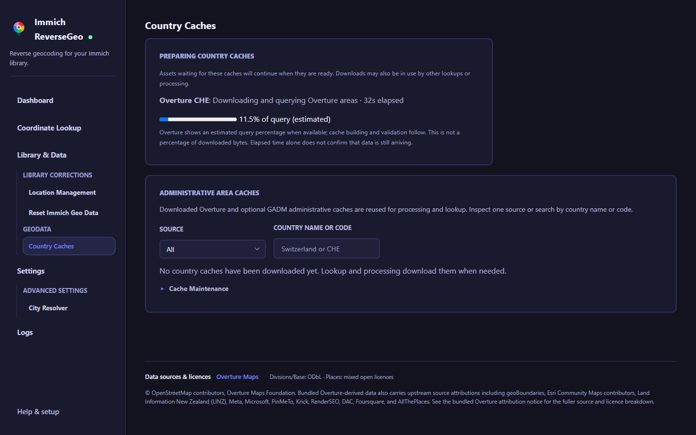

# Troubleshooting

<div class="section-intro">
Most issues come down to one of three things: the app cannot see the right database values, the app is still downloading country data, or the running process has stale state after a change.
</div>

## The app shows default DB values instead of my real ones

Open **Settings → Database Connection Details** and check the read-only values. Change database variables in Docker Compose or your host environment, then recreate or restart Immich ReverseGeo. Editing `settings.json` does not change database credentials. Use **Test Connection** after restarting.

## Country lookup says no match

Check:

- the bundled `overture-country-divisions.db` file exists in the bundled data directory inside the app image
- the running app was restarted after data or code changes
- the coordinate actually has latitude and longitude in immich

## A country cache download is slow

The first lookup for a new country can take longer because the per-country Overture division cache must be created locally.

Large countries can also produce much larger cache files than small ones.

Open **Country Caches** or check **Preparing country caches** on the scan page. The display shows the source, country code, stage, and elapsed time. GADM can show file bytes and a transfer percentage; Overture shows an estimated query percentage when available. Building and validating the cache happen afterward, so 100% of a transfer or query does not mean the cache is ready.

{ .doc-screenshot .on-glb }

If the stage stays unchanged, inspect **Logs** and check internet access, free space, and write permissions for `/data`. An increasing elapsed time does not prove the download is advancing. Avoid repeatedly re-downloading a country while investigating. See [cache preparation](./using-the-app.md#scan-progress-and-country-caches) for the progress limits.

<div class="feature-grid">
  <div class="card">
    <h3>First run is slower</h3>
    <p>The app has to download and prepare country data the first time you hit a country it has not seen before.</p>
  </div>
  <div class="card">
    <h3>Bigger countries take longer</h3>
    <p>Large countries usually mean larger downloads and more time spent preparing the local data.</p>
  </div>
</div>

## Processing seems slower than expected

Things that affect throughput:

- batch size
- parallel workers
- low-memory mode and country-boundary cache settings
- database latency to the immich PostgreSQL instance
- first-time per-country cache creation

<div class="step-grid">
  <div class="step-card">
    <h3>Start with the easy checks</h3>
    <p>If processing feels slow, first check whether the app is still downloading country data for the first time.</p>
  </div>
  <div class="step-card">
    <h3>Then tune settings</h3>
    <p>Check effective batch and worker limits under Settings → Processing. Low-memory mode uses one worker even if your saved parallel-worker value is higher.</p>
  </div>
</div>

## The container keeps restarting or gets killed

This usually means the container ran out of memory.

Check whether the restarts line up with processing runs:

```bash
docker inspect --format '{{.RestartCount}} {{.State.OOMKilled}}' immich-reversegeo
```

If `OOMKilled` is `true`, or the logs end with `System.OutOfMemoryException`:

1. Enable **Settings → Processing → Low-memory mode**, save, and start a new run. It uses one worker, batches of at most 25, and country boundaries read from disk. Work already in progress keeps its current limits.
2. Compare the first pass that prepares country caches with later passes that reuse them. Downloads and geometry checks can still need additional RAM.
3. Check the container memory limit. The [installation snippet](./installation.md#docker) uses `mem_limit: 2g` as a starting budget; large caches may require more. Lowering the limit does not reduce the app's memory needs.

If you want to retain normal parallelism, try **Limit country boundary cache** under **Advanced Processing Limits**, or reduce **Parallel workers**. Normal mode also releases idle country boundaries after five minutes by default. Released memory may remain available to the runtime before the host's RAM figure falls.

These settings trade speed and disk reads for lower memory use; none caps total app memory. Test known coordinates in Lookup before comparing runs. See [memory settings](./configuration.md#low-memory-mode) for the options and limits.

## A scan shows differences but nothing is ready to apply

**Differences found** counts the original scan differences, including ones already handled. **Ready to apply** shows only differences that have not been attempted. Switch to **Applied**, **Needs attention**, or **All results** to inspect outcomes. Uncheck **Show only different values** to include unchanged, unresolved, and failed results.

Open **Change History** to review pending apply or undo work. For **Needs review**, check the asset in Immich before another change. Run a new scan for skipped or undone assets, updated settings, or fresh proposals. See [Applying saved proposals](./using-the-app.md#applying-saved-proposals).

## I want to rerun everything from scratch

The Data page can clear existing `city`, `state`, and `country` values in immich.

See [Using the App](./using-the-app.md) for the reset options and what each one does.

Because this is a destructive write operation against immich metadata, back up your database first:

- [Backup and Restore | Immich](https://docs.immich.app/administration/backup-and-restore/)

## Settings cannot be read or saved

If logs report that `settings.json` cannot be read, scheduled processing pauses and retries once a minute. The file is left unchanged; the app does not substitute default settings for a damaged file.

Check that the `/config` volume is writable and restore `settings.json` from a known-good backup if its contents are damaged. Keep a copy of the damaged file while investigating. After restoring it, reload the Settings page and check the values before starting a run.

If a save fails, the previous settings file remains available. Check volume permissions and free disk space, then retry the save.

## Connection interrupted or session expired

The app tries to reconnect after a temporary connection failure. If the server no longer has your session, the dialog asks you to **Reload page** and warns that unsaved changes may be lost. Reload starts a new session; it does not recover unsaved form values.

If retrying does not work, check that the container is running and your private connection to it is available, then reload.

Disconnecting stops page-owned scans and remaining apply/undo work. A write already underway may finish. After reconnecting:

- Open **Location Management → Saved Scans** and choose **Continue scan** on an unfinished report. Checked results are kept; continuation uses the original scan settings. A completed scan needs no continuation.
- Open **Change History** to check apply/undo outcomes. Review pending work before resuming it. For **Needs review**, inspect the affected asset in Immich and run a new scan before another change; uncertain writes are not retried automatically.
- Check the **Dashboard** for background processing status. Reconnecting does not start another processing pass.

Reloading clears live checkbox selections and unsaved form edits. Reopen the saved report and select results again; saved reports and change history remain available as long as the `/data` volume is preserved.

## Overture release discovery fails

Check that the app can reach `https://stac.overturemaps.org/catalog.json`, then retry the lookup or country download. Overture keeps public releases for only 60 days, so the app does not fall back to a fixed older version. Existing downloaded country caches and built-in data remain usable without release discovery. Optional live Places diagnostics still need internet access.
