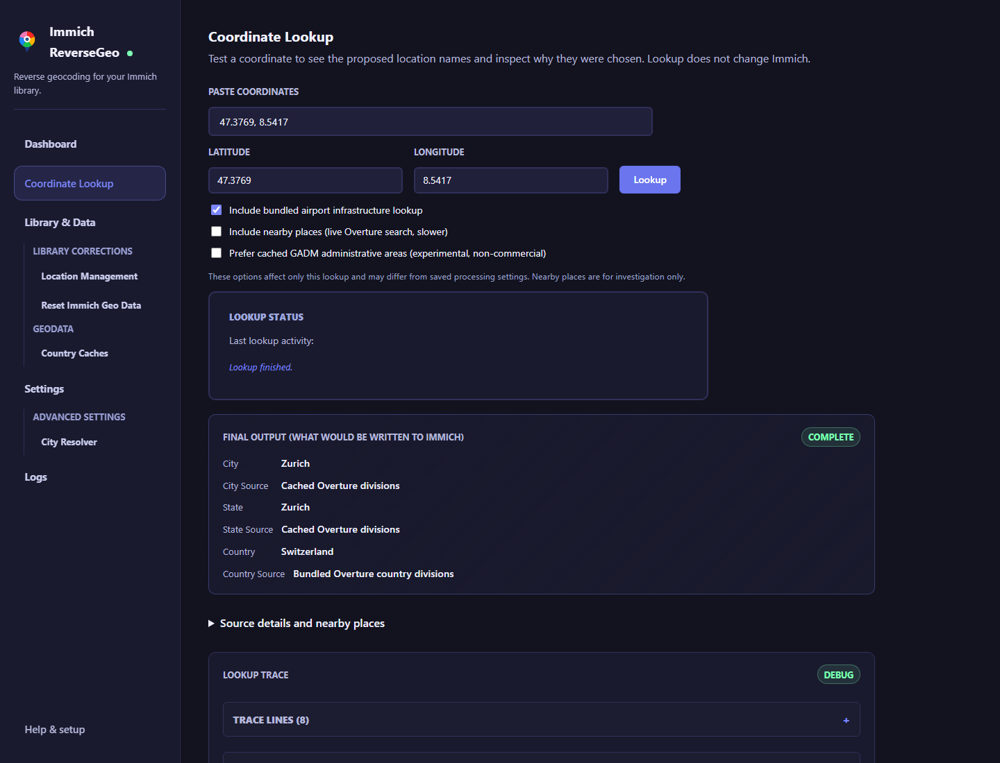
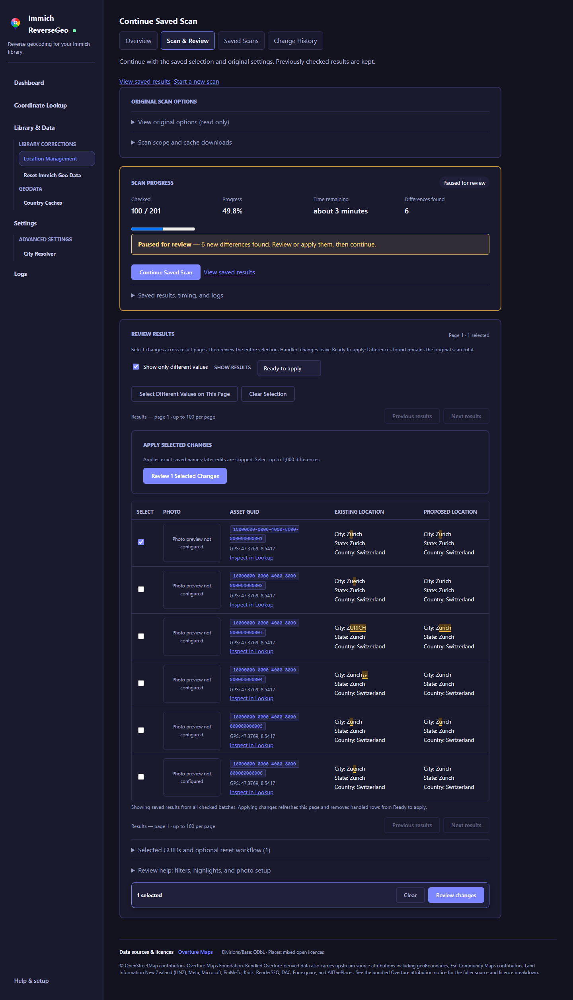
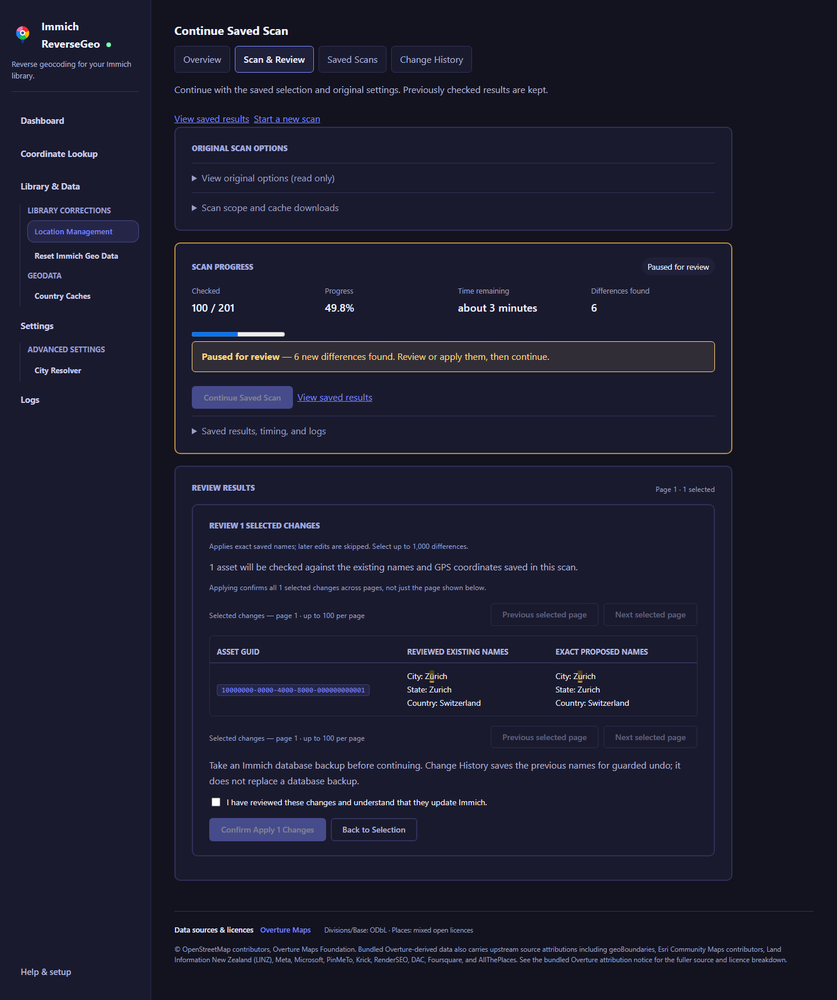
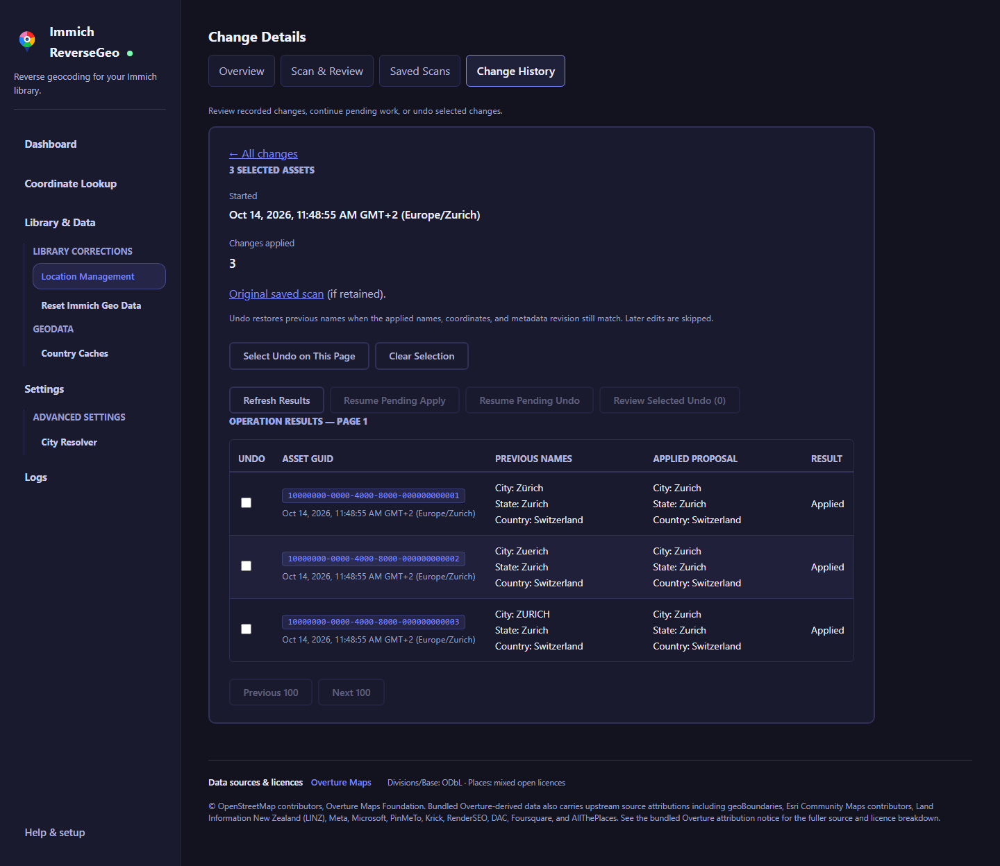
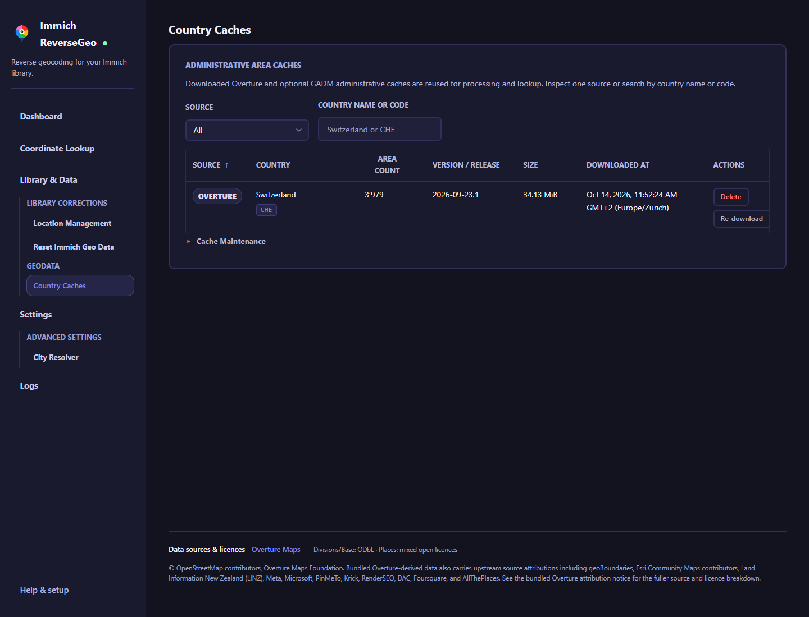

# Using the App

This page covers the day-to-day UI for Immich ReverseGeo after setup is complete.

For install-time settings such as database values, schedules, and processing limits, see [Configuration](./configuration.md).
For a source-by-source explanation of the geographic data behind the app, see [Data Sources](./data-sources.md).

Navigation groups library corrections, country caches, and advanced settings. On smaller screens, use **Open Navigation** to show the tools. Keyboard users can use **Skip to content**. **Help & setup** opens the public guides, and browser tab titles identify the current tool.

## Dashboard

Use `Run Now` on the Dashboard to start a manual processing pass immediately.

Runs process active assets with GPS coordinates only when **both city and country are missing**. Existing names are kept, even if they are incorrect. Assets on the skip list are excluded until you clear that list under Data. The unprocessed count includes eligible assets that may still be on the skip list.

To correct existing names, open [Location Management](#location-management), scan and review the proposed names, then apply only the differences you select. You can still reset selected assets and reprocess them if you prefer.

- it works even if automatic scheduling is turned off
- it uses your current Settings values for batch size, delay, parallelism, and airport matching
- the Dashboard shows assets checked, updated, skipped, and failed, plus recent activity
- the last run remains labelled Completed, Completed with errors, Cancelled, or Failed
- `Cancel` stops the current run

Use **Scan & Review Existing Names** on the Dashboard for the **Scan → Review → Apply** workflow. Reset and reprocessing remain available under **Advanced: reset and reprocess**; back up the database before either reset or apply.

Progress counts examined assets, including those already on the skip list. Missing Location Names includes assets on the skip list; On the Skip List shows the stored count loaded before the run and refreshed afterwards. Cancelling keeps location names already written. A completed pass does not mean every asset received a location.

Run-end and activity timestamps use your browser's local timezone, shown beside each time. This does not change the UTC processing schedule.

## Start a run from a script

After a photo sync, a script can start the same processing pass as **Run Now** with `POST /api/processing/run`. Call it after Immich has imported the assets and extracted their GPS metadata.

Call the URL from your script:

```sh
curl --fail-with-body --request POST http://localhost:8080/api/processing/run
```

Use the host and published port reachable from your script. No API key or request body is needed. `GET` does not start a run. Like the web UI, this endpoint has no built-in authentication: keep the service on your private network. Anyone who can reach it can start processing.

| HTTP response | Meaning |
|---|---|
| `202` with `status: accepted` | The background pass was accepted. Check Dashboard or Logs for progress and the final outcome. |
| `409` with `status: busy` | Processing or maintenance is active. No additional run was queued; retry after it finishes if newly imported assets still need processing. |

The response returns immediately; `202` does not mean processing succeeded or that every photo received a location. The pass uses your saved processing settings even when scheduling is disabled. It fills missing city and country names, keeps existing names, and respects the skip list, just like a Dashboard run. It cannot process media that Immich has not imported yet or that lacks GPS coordinates.

## Lookup

Use the Lookup page when you want to test a coordinate before running a full processing pass.

- paste or type coordinates to see how the resolver behaves for that point
- it shows the final proposed values first; expand **Source details and nearby places** or **Lookup Trace** to investigate how they were chosen
- `Include bundled airport infrastructure lookup` lets you test with or without airport matching for that lookup
- `Include nearby places` adds a slower live Overture search for investigation. It shows nearby suggestions and a small sample of excluded places; it does not change the location written to Immich
- `Prefer cached GADM administrative areas` switches the administrative area part of the lookup to an experimental on-demand GADM cache for that country; country detection still starts with the bundled Overture country data

{ .doc-screenshot .on-glb }

Click the screenshot to enlarge it. Lookup previews do not update Immich assets.

### Country lookup failures

Lookup distinguishes a point outside the bundled country coverage from a matched boundary whose country code cannot be resolved. If the country code cannot be resolved, check that the bundled country database and country catalog belong to the same app release. A missing boundary match can require newer geographic data; changing city settings will not add country coverage.

## Data tools

<a id="preview-location-corrections"></a>

### Location Management

Use the tabs in **Location Management** to switch between Overview, Scan & Review, Saved Scans, and Change History. The highlighted tab shows your current section.

Open **Library & Data → Location Management → Scan & Review** to compare existing city, state, and country names with proposed values from your current processing settings. Scanning is read-only; applying selected changes is a separate confirmed action. Existing preview URLs and saved reports remain available.

1. Choose pasted asset GUIDs, an exact existing city/state/country name, or the whole library.
2. Start the scan. It checks up to 100 assets per page and may download country caches. Every scope includes only assets with both GPS coordinates. It does not write to Immich or change the skip list.
3. Review the existing and proposed values. The **Ready to apply** view shows differences that have not yet been attempted. Different does not necessarily mean better: use **Inspect in Lookup** on a row to investigate unfamiliar results, then return to your review.
4. Select only the assets you want to correct. Selections are kept across review pages. Open **Review Selected Changes**, inspect the exact existing and proposed names, and take an [Immich database backup](https://docs.immich.app/administration/backup-and-restore/).
5. Acknowledge the confirmation and choose **Confirm Apply**. The app writes the saved proposed names directly; no reset or processing run is needed. Each operation supports up to 1,000 selected differences. Its results appear beside the assets and in **Change History**.

??? example "See a paused scan and selected differences"
    { .doc-screenshot .on-glb }

The scan and change-history screenshots use sample asset IDs and names. A highlighted spelling difference is an example of an exact text comparison, not a recommendation to replace a local name.

#### Compare names and filter results

In live and saved scans, changed characters are highlighted in both the existing and proposed names. The comparison is exact, so punctuation, capitalization, and spaces can mark a name as different even when it refers to the same place. Changed spaces appear as `␠`; other invisible characters use symbols or Unicode codes. Hover over a highlight to see its character codes. An empty value appears as `(empty)` and a missing value as `—`.

**Show only different values** is checked by default in live and saved scans. It combines with the status filter below. Uncheck it to include unchanged, unresolved, and failed results; choose **All results** or **Needs attention** to inspect them.

The **Show results** filter offers **Ready to apply**, **Applied**, **Needs attention**, and **All results**. Applied changes leave Ready to apply immediately, and the page fills with the next available differences. They remain visible in Applied, All results, and Change History. Needs attention includes skipped, pending, interrupted, unresolved, and failed lookup results. Undone changes remain in All results and Change History. Resume pending writes from Change History; inspect uncertain outcomes in Immich. Run a new scan before applying skipped or undone assets again.

Live scan inputs, results, filters, and selections survive navigation within the current browser session. Leaving an active scan cancels it; return to Scan & Review to continue after cancellation finishes. Reloading or losing the session clears the live review state; completed results remain in Saved Scans. New scans reset the live selection and filters.

#### Scan progress and country caches

Browse saved results from every checked batch with **Previous 100 Results** and **Next 100 Results**. **Scan Next 100** adds results without bringing already handled differences back into the ready list. **Start Scan** clears the selection and begins a new snapshot. After cancellation, you can review completed results and continue after the last checked asset. If no results have been saved yet, continuation starts at the beginning.

**Continuous scan** advances through all matching assets automatically. Set **Pause after this many new differences** to stop for review after a chosen number of changed results; use **0** to scan to the end. When the limit is reached, an amber **Paused for review** notice shows how many new differences were found. A pause banner stays above the results while you scroll, with a **Continue Scan** button. Reviewing or applying changes leaves the scan paused until you continue. **Continue Scan** resumes after the last saved asset and pauses after the next group of differences. Unresolved results and errors do not count as differences. The review table shows up to 100 results matching your filter from all checked batches; the saved report contains every completed result.

Keep the scan page open while scanning. Navigating away, reloading, or closing the browser stops the scan when the page disconnects. It is not a background job. Saved results remain available. Return to the live review within the same browser session, or use Saved Scans → Continue scan after a reload or restart.

Choose **Order by → Nearby coordinates** to group photos into quarter-degree map tiles, helping nearby lookups reuse cached data. This can reduce switching between country caches, particularly with the bounded country cache, but each uncached country still needs preparing. Sorting can increase database query time for large libraries; use **Asset GUID** order if loading matching assets takes too long. Start a new scan to change the order. Both orders support continuing after the last checked asset on cancellation.

While a scan runs, the page shows the current asset, lookup step or country-cache wait, and elapsed time. The progress bar counts checked assets, not downloaded data. Preparing a country for the first time can take several minutes; later lookups reuse its cache. To investigate a long wait, open **Logs** from the scan page. Scan events include a short identifier so you can follow one preview's start, cache waits, failures, cancellation, and page summaries. These events also appear in the container logs. Successful cached lookups are summarized rather than logged for every asset.

A scan counts all matching assets with both GPS coordinates when you start and shows the total checked and percentage across manual pages and continuous scans. Estimated remaining processing time appears after five checked assets and excludes review pauses. Country-cache downloads can change the estimate. Use **Scan Next 100** or **Continue Scan** to resume after a pause. If assets are added, deleted, or edited during the preview, the starting total may no longer match the final count.

While a scan waits for a country cache, **Preparing country caches** shows its source, country code, current stage, and elapsed time. The same status appears on **Country Caches**. GADM file downloads show bytes received and a transfer percentage when the server supplies the total size; building and validating the cache happen afterward. Overture shows an estimated query percentage during the download/query phase when available, then saved-area counts while building the cache. Its query percentage does not measure downloaded bytes or completion of the whole cache. While connecting, reading metadata, or whenever no estimate is available, the display shows the current stage without a percentage. Elapsed time alone does not confirm that data is still arriving. This display does not make downloads faster; if a stage stays unchanged, check **Logs**, network access, and free disk space.

Settings are loaded once when you start the scan; start again after changing settings. Results may change if settings, source data, or coordinates change before processing.

Photo thumbnails and **Open in Immich** links are available in live scans and saved reports when the optional [Immich connection](./configuration.md#photo-previews-and-immich-links) is configured. Thumbnails load on demand only for rows with different proposed values. Rows without differences do not request thumbnails, even when shown in All results; they are not part of the saved snapshot and may become unavailable if an asset is deleted or access changes.

#### Saved scans

Use **Show scans → Can continue** to find unfinished scans. **Needs attention** finds failed or interrupted scans and reports with a saved error. Filters search all saved reports, including older pages; changing a filter returns to page 1.

Each completed asset result is saved automatically under **Location Management → Saved Scans**, including results checked before you cancel. Open a report later to compare the saved existing and proposed names, filter to differences, and copy GUIDs you have reviewed across pages. Viewing a saved report does not run new lookups or change Immich. Selections made with checkboxes are kept only while that report is open; the saved results remain available after a reload or app restart.

Reports store the selection, processing settings, asset GUIDs, GPS coordinates, names, and lookup failures in `location-previews.db` under your `/data` volume. Preserve that volume to keep reports across container replacements. Reports stay until you delete them from the report page; deleting a report removes only its local snapshot. A report marked **More assets available**, **Paused**, **Cancelled**, or **Interrupted** covers only the assets already checked. Choose Continue scan to check remaining assets after a restart, using the original options.

Saved values may be out of date if Immich metadata, coordinates, settings, or source data changed afterward. Run a new scan to check current proposals, or review the saved proposals before applying; changed names and coordinates are skipped. If saving fails, the scan stops with an error; results already saved are retained.

Deleted assets, GUIDs without an Immich metadata row, and assets missing either latitude or longitude are excluded from every scan query, including pasted GUIDs. Unresolved locations and lookup failures are shown separately and cannot be selected for correction. Scanning can help find inconsistent names; it cannot recover missing GPS coordinates or guarantee that a proposed name is correct.

For the optional reset workflow, choose **Review Reset for Selected Assets** in the live review. The reset page carries your selected GUIDs into a separate count-and-confirm step. Take a database backup, review the fields being cleared, then confirm. Reset does not apply saved proposals; use **Go to Dashboard to Reprocess** afterwards. Reset assets cannot be selected again in that live review until you start a new scan.

#### Continue an unfinished scan

Saved Scans keeps each scan's status, checked results, original selection and settings, and latest saved position. New scans also save their original asset total, active scan time, batch position, and pause count. A scan interrupted by an app restart is marked **Interrupted**.

1. Open **Location Management → Saved Scans** and choose **Continue scan** on an unfinished report, or open its saved results and choose **Continue scan** there.
2. The continuation page restores the original scan options and shows the saved results. Choose **Continue Saved Scan** or the pause banner's **Continue Scan** button to start checking remaining assets.
3. Results are added to the same report. Continuous mode pauses after the next group of new differences; manual mode checks the next page.

Paused, cancelled, interrupted, failed, and unfinished manual scans can be continued. A completed or currently running scan cannot. Only one page can run a given scan at a time. Leaving the page still stops page-owned work; you can continue it again later.

Continuation starts after the last successfully saved asset and skips assets already in the report, including saved failed lookups. Older unfinished reports use their last saved result as the resume position; totals and timing that were never recorded cannot be recovered. Start a new scan to retry earlier failures, use updated settings, or include assets added or moved earlier in the scan order. New lookups use currently available location data.

#### Applying saved proposals

You can apply selected differences from a live scan or a saved scan. The app uses the exact saved proposed names, without running another lookup. It compares the current city, state, country, and GPS coordinates with the reviewed snapshot before each write. Assets with changed values, deleted assets, and missing metadata rows are skipped. Unresolved and failed lookup results cannot be applied. Punctuation-only changes are still differences; review them before selecting.

Applying changes updates only city, state, and country. GPS coordinates and other metadata are preserved. Refresh the asset in Immich to see its new names. Scheduled metadata extraction or other apps can subsequently replace those names; run a new scan if the current results differ.

Selection and confirmation are separate steps. Use **Next results** to select differences across pages, then review the whole selection. **Next selected page** pages through that confirmation; applying writes all selected changes, not only the visible page. Use **Back to Selection** to change your selection. Refreshing the report requires a fresh confirmation.

??? example "See the apply confirmation"
    { .doc-screenshot .on-glb }

After applying, the app returns to the first page of **Ready to apply** and keeps the operation summary and history link visible. The scan's **Differences found** count includes handled changes. When no checked differences remain ready, continue an unfinished scan or inspect **Applied**, **Needs attention**, or **All results**. On small screens, scroll comparison tables horizontally to read the existing and proposed names.

#### Change history, undo, and interruption

Use **Show operations → Pending work** to find operations with apply or undo work waiting or underway. **Needs review** finds uncertain write outcomes that need checking in Immich. These filters cover all operations before pagination, and an operation can match both. Open it to check current outcomes before resuming work.

**Location Management → Change History** records each selected operation and its per-asset outcomes. Open an operation to see its saved previous names, exact proposals, timestamps, and applied, skipped, pending, or **Needs review** results. Select applied rows, review the previous names to restore, and confirm **Undo**. Undo requires the current applied names, GPS coordinates, and metadata version to match; any later metadata edit is skipped, even if its location names are identical.

??? example "See recorded changes and undo controls"
    { .doc-screenshot .on-glb }

The history overview shows pending apply and undo work separately. If any selected change is no longer eligible for undo, the app queues none of that selection; refresh the results and review your selection again.

Cancel or leave the page to stop remaining work. A write already underway may complete. Pending items have not been attempted and can be resumed from Change History after confirmation. Applied items are not retried. If the app loses the connection or stops between a database write and saving its outcome, the item is marked **Needs review**. Check that asset in Immich and run a new scan before making another change; uncertain items are never retried or undone automatically.

Previous names and operation results are saved in `location-changes.db` under `/data`, separately from saved scans. Preserve this volume to retain history and undo information. Deleting a saved scan does not delete its change history. The journal contains location metadata; protect it along with your other app data. It does not replace an Immich database backup, and undo cannot restore deleted assets or override later edits.

#### Reviewing location results

After selecting results, a sticky bar keeps the selected count, **Clear**, and **Review changes** within reach. Change History offers **Review undo** for selected applied rows. Review still opens the exact-name confirmation; the bar does not apply or undo changes. Keyboard focus moves to the review heading and returns to the initiating control when you cancel.

Scan setup, progress, and results appear in separate sections. On a continued saved scan, expand **Original scan options** to see the settings used for that scan. Pause reasons and errors remain visible beside the scan action.

Select differences in the results table, then review the exact names before applying. Expand **Review help** for filter descriptions, highlighted differences, and photo setup. Saved reports keep scan details and deletion controls in expandable sections. Change history shows recorded outcomes and warns when a write needs checking in Immich.

### Maintenance actions

The Data area contains maintenance tools that change downloaded caches or Immich reverse geo values.

| Page or action | What it does |
|---|---|
| `Location Management` | Scan and review names, apply selected differences, and inspect or undo changes. |
| `Clear Skip List` | Removes permanently skipped assets so they can be retried on the next run. |
| `Reset All Location Names` | Under Advanced, confirms clearing names from every metadata row with stored names, including deleted assets, and clears the skip list. |
| `Reset Selected Assets` | Reviews a scan selection or pasted GUIDs, then confirms clearing their names and removing them from the skip list. |
| `Reset by Existing Location` | Reviews an explicitly selected city, state, or country and confirms clearing all three fields for matching active assets. |
| `Delete Overture cache` | Removes one downloaded Overture country cache file. |
| `Re-download Overture cache` | Replaces one downloaded Overture country cache with a fresh copy. |
| `Review Deleting All Overture Caches` | Removes every downloaded country cache so they will be fetched again on demand later. |
| `Delete GADM cache` | Removes one downloaded GADM country cache file. |
| `Re-download GADM cache` | Replaces one downloaded GADM country cache with a fresh copy. |
| `Review Deleting All GADM Caches` | Removes every downloaded GADM cache so they will be fetched again on demand later. |

The Reset Immich Geo Data page only clears reverse geo values in `asset_exif`. It does not touch any other Immich metadata.

Reset review rechecks the affected count before writing. If it changes, review the updated count and confirm again. Processing, apply/undo, resets, and cache writes cannot overlap; wait for active work to finish before starting another operation. Reset reports partial completion if names were cleared but skip-list cleanup failed.

Country Caches supports country names and codes. Country names and download times wrap within their columns; on narrow screens, scroll the table horizontally to reach the action buttons. Deleting a cache does not change Immich metadata; it downloads again when needed. Bulk deletion is under **Cache Maintenance** and requires confirmation. A failed re-download can leave a cache unavailable; check network access, disk space, and permissions before retrying.

{ .doc-screenshot .on-glb }

Overture administrative names prefer English when available, including names taken from parent areas. Local names remain the fallback when English is unavailable. If an older cache still shows a local name despite an English name being available, use **Re-download Overture cache** for that country, then check the coordinates in **Lookup**. Re-downloading does not update existing Immich metadata; use **Location Management → Scan & Review** to review and apply any desired changes.

## Logs

Use the Logs page when you want to inspect recent activity outside the Dashboard summary.

- filter the in-app log view to all messages, warnings and errors, or errors only
- download the current filtered view as `immich-reversegeo.log`

The log panel fills the available page height and scrolls within the panel. **Follow logs** is enabled by default and keeps the log panel scrolled to the latest entry. Uncheck it to read older entries without automatic scrolling. Check it again to jump to the latest entry and resume following new activity.

On-screen timestamps use your browser's timezone. Downloaded logs use full UTC timestamps with dates so you can compare activity across systems. While the interactive page is connecting, timestamps are shown in UTC.

Only the latest 100 activity entries are retained, and they are cleared when the app restarts. **Download Filtered Recent Logs** exports the current filtered entries, not a complete run history. Use container or host logs for older or more detailed diagnostics.
